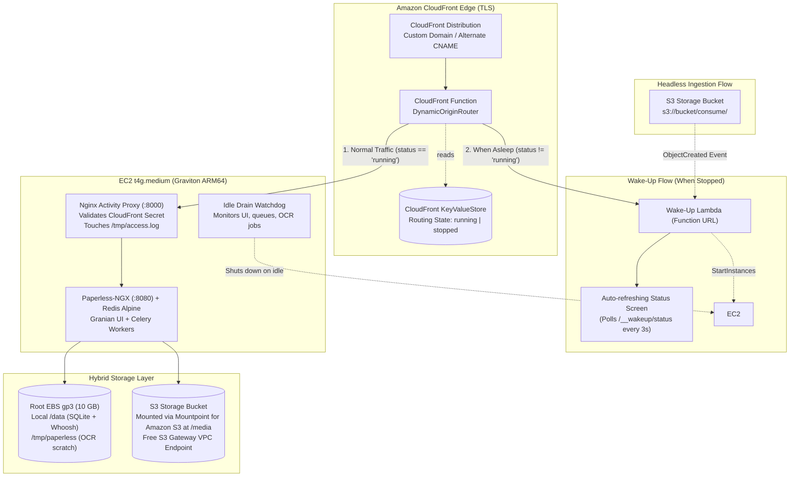

## The Problem with Traditional Cloud Self-Hosting

Paperless-NGX is an exceptional open-source document management system, but hosting it in public cloud infrastructure typically creates prohibitive monthly bills:
- Always-on EC2 instances (even modest `t4g.small` or `t3.medium`) run 730 hours/month.
- Managed relational databases (Amazon RDS PostgreSQL) add $20–$40/month.
- Elastic File System (EFS) or provisioned storage carries continuous hourly IOPS and throughput charges.
- NAT Gateways add ~$32/month just for idle routing.

For a personal home archivist scanning a handful of utility bills, tax receipts, or medical forms per week, a $70–$100/month bill is hard to justify when a physical Raspberry Pi runs at home for pennies in electricity. However, home servers suffer from hardware failures, power outages, SD card corruption, and port-forwarding security risks.

## The On-Demand Solution

**Paperless-NGX On-Demand** bridges this gap by deploying an Infrastructure-as-Code (AWS CDK in TypeScript) architecture designed specifically for **single-tenant personal archiving**:

### Lifecycle Walkthrough

1. **Stopped State ($0.00/hr compute)**:
   The EC2 Graviton instance is stopped. The CloudFront KeyValueStore (KVS) maintains `instance_status: "stopped"`.
2. **User Arrives at Domain**:
   CloudFront Function inspects the KVS at edge (sub-millisecond). Seeing `"stopped"`, it dynamically routes the HTTP request to the Wakeup Lambda function.
3. **Instance Spin-Up**:
   The Wakeup Lambda issues an EC2 `StartInstances` API call and immediately responds with a fast, responsive HTML splash screen that polls the Lambda status every 3 seconds.
4. **Boot & Sync (~45–60 seconds)**:
   The instance boots Amazon Linux 2023. The `boot-sync.sh` systemd service pulls the latest SQLite database backup from S3, mounts the S3 media bucket via Mountpoint for Amazon S3 (`mount-s3`), and launches Paperless-NGX and Redis via Docker Compose.
5. **Edge Switchover**:
   As soon as health checks succeed on port 8000, the instance updates the CloudFront KVS to `"running"`. Subsequent web requests route directly to EC2 with zero Lambda invocation latency.
6. **Task Drain & Safe Sleep**:
   A multi-layer watchdog monitors Celery task queues, HTTP traffic, OCR worker processes, and CPU utilization. When idle for 20 minutes with all indexing drained, it executes an automated SQLite `.backup`, syncs it to S3, updates KVS to `"stopped"`, and calls `aws ec2 stop-instances`.

