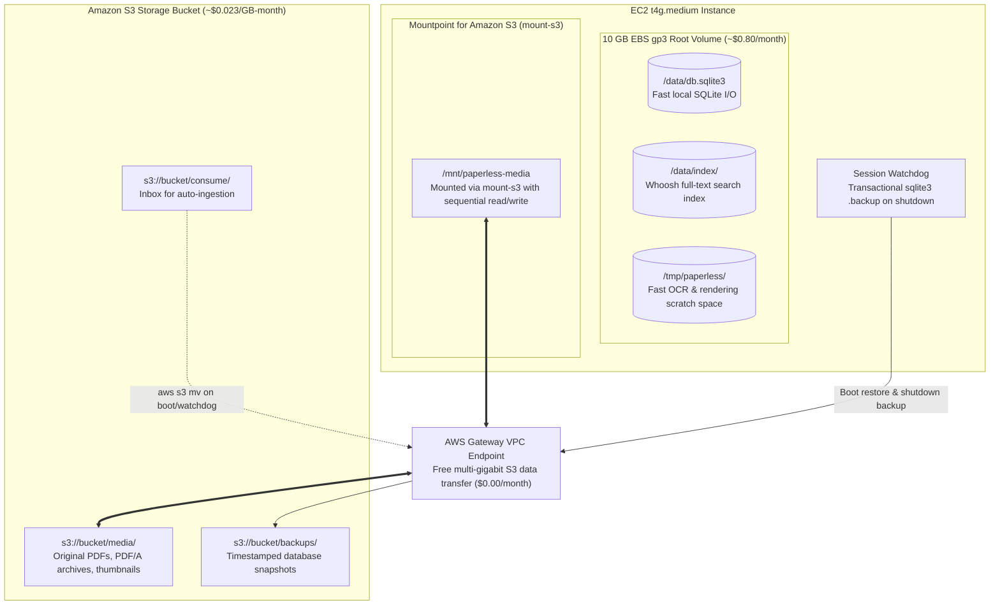

Paperless-NGX stores two distinct classes of data:
1. **High-IOPS Transactional State**: SQLite relational database (`db.sqlite3`), Whoosh search index, and OCR temporary scratch files.
2. **Persistent Document Binaries**: Original PDFs, OCR-converted PDF/A archives, and thumbnail images.

Running SQLite directly on network file systems (like S3 or NFS) causes locking contention, slow indexing, and database corruption. Paperless-NGX On-Demand solves this with a **hybrid local-EBS + S3 architecture**.

---

## Storage Architecture Overview



---

## 1. Unified S3 Storage Layout

All persistent assets live in a single, private S3 bucket organized into three root prefixes:

| S3 Prefix | Purpose | Lifecycle / Durability |
| :--- | :--- | :--- |
| **`media/`** | Document archive files, originals, and thumbnail PNGs mounted at `/media`. | 99.999999999% (11 9s) durability. S3 Intelligent-Tiering or Standard. |
| **`consume/`** | Drop directory. Dropping any file into this prefix triggers document ingestion. | Ephemeral; Paperless processes and moves ingested documents into `media/`. |
| **`backups/`** | Timestamped SQLite snapshots created by the watchdog on shutdown. | Versioned snapshots for disaster recovery. |

---

## 2. Fast Media Access via Mountpoint for Amazon S3 (`mount-s3`) and Gateway VPC Endpoint

The media directory is mounted inside the EC2 instance using **Mountpoint for Amazon S3** (`mount-s3`), AWS's official, high-performance file client:
- **Optimized for Object Storage**: Directly translates local filesystem calls into optimized S3 API requests using AWS's high-throughput C++ S3 client library.
- **Sequential Streaming**: Document previews and thumbnail images stream with native S3 bandwidth, eliminating local disk caching overhead.
- **S3 Gateway VPC Endpoint**: All traffic between EC2 and S3 routes through an AWS VPC Gateway Endpoint. **Gateway Endpoints are completely free of charge** and incur zero data transfer costs within the region.

---

## 3. SQLite Sync & Disaster Recovery

Because SQLite and the Whoosh search index live on the local EBS volume, Paperless-NGX enjoys native NVMe-grade read/write performance when running OCR jobs:

- **On Boot (`boot-sync.sh`)**: The instance checks S3 for the most recent database backup snapshot. If the local volume is fresh or recovering from a hardware swap, it restores the database snapshot in seconds.
- **On Shutdown (`watchdog.sh`)**: The instance runs an atomic SQLite backup:
  ```bash
  sqlite3 /data/db.sqlite3 ".backup /tmp/paperless-backup.sqlite3"
  aws s3 cp /tmp/paperless-backup.sqlite3 "s3://${BUCKET}/backups/db-$(date +%Y%m%d-%H%M%S).sqlite3"
  ```
- **Durability**: Even if the EC2 instance or EBS volume were completely terminated, your documents, full database history, metadata, tags, and users are safely preserved in S3.

