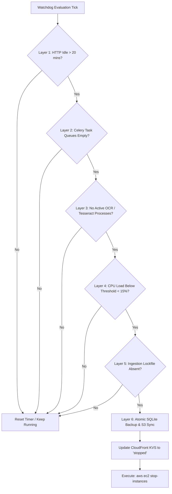

The core challenge of scaling a document processing application to zero is ensuring that the instance never shuts down while background OCR, full-text indexing, or database transactions are actively processing.

Paperless-NGX On-Demand solves this with a **6-Layer Watchdog Daemon** (`runtime/watchdog.sh`) running continuously as a systemd service on the EC2 host.

---

## The 6 Drain Verification Layers

Before initiating an instance shutdown, the watchdog verifies that all six operational layers have settled into an idle state:



### Layer 1: HTTP Inactivity
An activity-tracking reverse proxy (Nginx or Caddy) logs timestamped access records for incoming requests. The watchdog checks the delta between the current timestamp and the last client request. If traffic has occurred within the configured inactivity window (default: 20 minutes), the timer resets.

### Layer 2: Celery Queue Drain
Paperless-NGX offloads document parsing, thumbnail generation, OCR, and search indexing to asynchronous Celery workers backed by Redis. The watchdog queries Celery and Redis to verify that:
- The `celery` queue is empty (`LLEN celery == 0`).
- No active or reserved tasks are being processed by worker nodes.

### Layer 3: Process Inspection
The watchdog inspects the Linux process table to ensure no active document transformation binaries are running:
- `tesseract`
- `ocrmypdf`
- `pdftoppm`
- `gs` (Ghostscript)
- `qpdf`

If any of these binaries are executing, shutdown is deferred regardless of queue metrics.

### Layer 4: CPU Load Threshold
Heavy indexing can saturate multiple CPU cores. The watchdog computes recent CPU load over a 60-second window. If CPU utilization exceeds 15%, background tasks are assumed to be ongoing.

### Layer 5: Consumption Lockfile Check
When files are dropped into the S3 inbox bucket or local consumption folder, an ingestion lockfile (`/tmp/paperless-consume.lock`) is acquired. The instance will not shut down while this lock is present.

### Layer 6: Atomic Database Backup & S3 Sync
Once all five conditions pass, the watchdog executes the pre-shutdown backup procedure:
1. Performs an atomic SQLite backup:
   ```bash
   sqlite3 /data/db.sqlite3 ".backup /tmp/paperless-backup.sqlite3"
   ```
2. Compresses and syncs the database backup and search index to your private S3 bucket:
   ```bash
   aws s3 cp /tmp/paperless-backup.sqlite3 "s3://${S3_BUCKET}/backups/db-$(date +%Y%m%d-%H%M%S).sqlite3"
   ```
3. Updates the CloudFront KeyValueStore to `"stopped"`.
4. Issues `aws ec2 stop-instances --instance-ids $(ec2-metadata -i)` to cleanly halt the machine.
